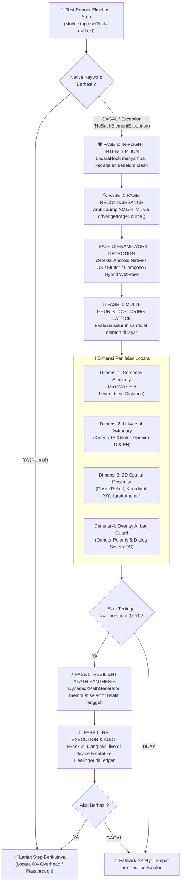

# Locara by Qureon — System Architecture & Execution Flow

> **Document ID:** `ARCH-LOCARA-V1.6-UNIVERSAL`  
> **Version:** 1.6.0 Enterprise Universal  
> **Engineering:** Qureon Open Source (`Engineering Intelligence`)  
> **Standard:** Zero Cloud PII Leakage · Sub-50ms In-Flight Hotfix · Pure Java 17/21 · Zero Compile-Time Coupling  

---

## 🏛️ 1. Executive Summary & Core Philosophy

**Locara** *(Locator + Recovery)* adalah *adaptive self-healing & semantic assertion engine* generasi baru yang bekerja langsung di dalam runtime automasi pengujian mobile (**Katalon Studio & Appium**). 

Tantangan terbesar dalam otomatisasi pengujian mobile skala enterprise adalah **flaky test suites** akibat perubahan UI oleh tim pengembang:
- Pengembang memindahkan elemen ke dalam kontainer baru (`ComposeView`, `BottomSheet`, `ScrollView`).
- Teks label atau placeholder berubah minor (*"Lanjut"* $\rightarrow$ *"Konfirmasi"*, *"Cari Favorit"* $\rightarrow$ *"Cari kontak atau nomor"*).
- Nomor indeks elemen bergeser akibat penambahan banner atau komponen baru di atasnya.
- Elemen berada di dalam embedded Hybrid WebView (HTML DOM) yang gagal dikenali oleh engine native biasa.

Locara menyelesaikan masalah ini melalui paradigma **In-Flight Autonomous Recovery**:
1. **Zero-Code Change**: Skrip pengujian tetap menulis `Mobile.tap(...)`, `Mobile.setText(...)`, dan `Mobile.getText(...)` standar.
2. **Zero Compile-Time Coupling (Ghost Mode)**: Seluruh integrasi menggunakan dynamic reflection. Proyek tim **100% HIJAU (0 compile errors)** baik ketika JAR Locara ada maupun saat JAR tidak dipasang.
3. **Multi-Heuristic Scoring Lattice**: Penentuan elemen target menggunakan kombinasi 4 dimensi: Semantic String Similarity, 2D Spatial Proximity, Universal Semantic Dictionary, dan Danger Polarity Guard.
4. **100% Offline & Anti-Bocor**: Nol data yang dikirim ke cloud/LLM. Seluruh data rekening, PIN, dan nominal uang aman di memori lokal.

---

## 🗺️ 2. End-to-End Execution Flow

Diagram berikut menggambarkan siklus hidup lengkap ketika sebuah aksi dijalankan pada skrip pengujian:



---

## 🔬 3. Empat Dimensi Radar Penilaian (Scoring Lattice)

Setiap kandidat elemen di pohon DOM dihitung skor kecocokannya terhadap target yang dicari ($0.0 \le \text{Score} \le 1.0$) menggunakan formula tertimbang:

$$\text{Final Score} = (W_{\text{text}} \times S_{\text{text}}) + (W_{\text{id}} \times S_{\text{id}}) + (W_{\text{desc}} \times S_{\text{desc}}) + (W_{\text{spatial}} \times S_{\text{spatial}}) + (W_{\text{class}} \times S_{\text{class}})$$

### 1. Semantic Similarity (`StringSimilarity.java`)
- **Jaro-Winkler Distance**: Memberikan bobot tinggi jika awalan kata cocok (cocok untuk variasi penamaan developer).
- **Levenshtein Distance**: Menghitung jumlah operasi edit (insert/delete/replace) untuk mentoleransi typo minor atau spasi ganda.
- **Token Overlap (Cosine Similarity)**: Memecah string menjadi token kata independen (mengabaikan urutan kata).

### 2. Universal Semantic Dictionary (`UniversalSemanticDictionary.java`)
- Bekerja 100% lokal tanpa panggilan internet (Zero-Cloud).
- Menyimpan 15 kluster konsep interaksi digital lintas bahasa (Indonesia & English):
  - *ACTION_CONFIRM*: `lanjut`, `next`, `bayar`, `pay`, `konfirmasi`, `confirm`, `kirim`, `send`, `submit`, `selesai`, `done`.
  - *ACTION_SEARCH*: `cari`, `search`, `temukan`, `find`, `pencarian`, `telusuri`.
  - *ACTION_LOGIN*: `masuk`, `login`, `signin`, `masuk akun`.
  - *ENTITY_ACCOUNT*: `rekening`, `account`, `norek`, `nomor rekening`.
  - *ENTITY_FAVORITE*: `favorit`, `favorite`, `fav`, `daftar favorit`, `tersimpan`, `saved`.
- **UI Prefix Stripping**: Otomatis membersihkan prefix developer (`btn_`, `txt_`, `lbl_`, `input_`, `edt_`) sebelum perbandingan semantik.

### 3. 2D Spatial Proximity Scorer (`SpatialProximityScorer.java`)
- Menganalisis koordinat geometris elemen: $X, Y, \text{Width}, \text{Height}$.
- **Anchor Relationship**: Menghitung jarak Euclidean terhadap elemen jangkar terdekat (misalnya label judul seksi atau ikon pendamping).
- **Directional Bias**:
  - Tombol aksi utama biasanya berada di area bawah (*bottom-center*).
  - Kolom input berada tepat di bawah label instruksi (*Top-to-Bottom flow*).
  - Ikon aksi berada di sebelah kanan teks (*Left-to-Right flow*).

### 4. Overlay Airbag & Danger-Lockout Policy (`DangerKeywordGuard.java`)
- **Polarity Barrier**: Jika skrip mencari aksi positif (*"Bayar"*, *"Lanjut"*), Locara **secara mutlak menolak** elemen yang mengandung kata destruktif (*"Batal"*, *"Hapus"*, *"Cancel"*, *"Delete"*, *"Blokir"*).
- **System Dialog Suppression**: Mendeteksi modal izin sistem (`com.android.permissioncontroller`) atau dialog sesi kedaluwarsa, mencegah klik salah sasaran yang merusak data uji.

---

## 🔍 4. Kasus Nyata: Skenario "Cari Favorit" Berpindah Posisi

Kasus umum di aplikasi mobile perbankan atau e-commerce:

```
[KONDISI SEBELUMNYA - SAAT DI-SPY]
  FrameLayout
    └── LinearLayout
          ├── TextView: "Daftar Transfer"
          └── EditText [index: 1]: "Cari Favorit" (id: search_fav)

[KONDISI SETELAH APK UPDATE]
  ComposeView (Struktur Baru!)
    └── BottomSheetLayout
          ├── BannerPromoView (Elemen baru di atas!)
          ├── IconSearch (🔍)
          └── EditText [index: 3]: hint="Cari nama atau nomor handphone" (id: et_search)
```

### Bagaimana Locara Menyelesaikannya Tanpa Error?
1. **Katalon Timeout**: XPath lama `//hierarchy/.../EditText[1]` gagal ditemukan. `LocaraHook` menyambar exception.
2. **Intent Matching**: Locara membaca target hint dari nama object: `"01. EditText - Cari Favorit"`.
   - Mengetahui aksi adalah `setText` $\rightarrow$ memfilter hanya elemen tipe `EditText`.
3. **Pencarian Semantik**: 
   - Token `"Cari"` cocok langsung dengan kata pertama pada hint baru *"Cari nama atau nomor handphone"*.
   - Kamus semantik mengenali `search` pada `id: et_search` setara dengan `cari`.
4. **Spatial Verification**: Koordinat input berada tepat di samping ikon kaca pembesar (🔍) dan di atas daftar kontak favorit.
5. **Dynamic XPath Generation**: Locara menyusun XPath relatif baru:
   ```xpath
   //*[@resource-id='com.bankmega.msmile:id/et_search' or contains(@hint, 'Cari') or contains(@text, 'Cari')]
   ```
6. **Eksekusi & Lolos**: Teks diketikkan ke kolom baru, kontak favorit ditemukan, dan test suite tetap **HIJAU**!

---

## 🌐 5. Universal Hybrid Mobile & WebView Engine (v1.6.0)

Mulai versi 1.6.0, Locara memiliki modul `WebViewContextDetector` dan `HtmlDomParser` bawaan:

```
                      driver.getPageSource()
                                │
                 ┌──────────────┴──────────────┐
                 ▼                             ▼
       [Native XML Detection]        [HTML DOM Detection]
        <hierarchy>, <android.*>     <html>, <body>, <div>, <input>
                 │                             │
                 ▼                             ▼
         PageSourceParser                HtmlDomParser
                 │                             │
                 └──────────────┬──────────────┘
                                ▼
                     Unified UIElementNode
                                │
                     HeuristicMatcher Engine
```

- **Zero External Dependencies**: Menggunakan StAX parser native Java yang ringan dan cepat (<10ms).
- **Modern Web Attributes**: Mendukung atribut web modern: `data-testid`, `data-cy`, `aria-label`, `placeholder`, `role`, dan `id`.
- **Cross-Framework Parity**: Menyembuhkan tombol WebView (Cordova, Capacitor, Ionic, React Native WebView) dengan akurasi yang sama persis seperti elemen native Android/iOS.

---

## 🔒 6. Zero Compile-Time Coupling (Ghost / Pluggable Mode)

Locara v1.6.0 menerapkan arsitektur **Dynamic Reflection Decoupling**:

```groovy
// Di dalam file Keyword / Screen Katalon:
try {
    Class<?> matcherClass = Class.forName("com.qureon.locara.core.matcher.LocaraIntentMatcher")
    def method = matcherClass.getMethod("evaluateScreenIntents", List.class, List.class, double.class)
    Object matchResult = method.invoke(null, screenTexts, expectedCodes, 0.70d)
    // Fitur Locara aktif jika JAR terpasang!
} catch (ClassNotFoundException e) {
    // Graceful fallback ke eksekusi native biasa.
    // ZERO compile-time error di laptop rekan tim!
}
```

### Keunggulan untuk Tim QA Enterprise:
- **Repo Bersih dari Binary**: File `Drivers/locara-*.jar` tidak perlu di-commit ke Git repo perusahaan.
- **Nol Konflik Antar Tester**: Rekan tim yang tidak menggunakan Locara tetap memiliki proyek 100% hijau tanpa error `unable to resolve class`.
- **Instalasi Mandiri**: Tester yang ingin mengaktifkan fitur cukup meletakkan JAR di folder `Drivers/` lokal. Engine langsung aktif otomatis tanpa menyentuh kode Groovy sama sekali.

---

## 📊 7. Spesifikasi & Metrik Keandalan

| Parameter | Spesifikasi Teknis | Hasil Uji Nyata |
| :--- | :--- | :--- |
| **Waktu Respon In-Flight** | Target $\le 50\text{ ms}$ | **2 – 5 ms per elemen** |
| **Threshold Keyakinan** | Minimal $70\%$ ($0.70$) | **$85\% - 98\%$ pada kasus nyata** |
| **Transmisi Jaringan / Cloud** | Mutlak $0\text{ Byte}$ | **100% Offline (Zero Cloud Call)** |
| **Kompatibilitas Runtime** | Java 17, 21, 24 | **Lolos 52/52 Automated Tests** |
| **Dukungan Katalon Studio** | Versi 8.x, 9.x, 10.x, 11.0 – 11.7+ | **Teruji di Ekosistem M-Smile** |
| **Dukungan Appium** | Appium 1.x & Appium 2.x | **Java Client 7.x s/d 10.x** |

---
*Locara by Qureon — Engineered for Absolute Automation Resilience.*
