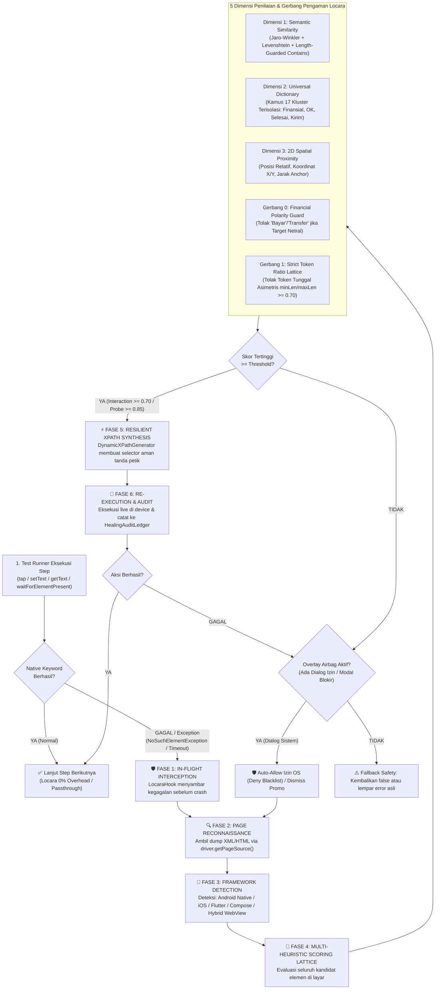

# Locara by Qureon — System Architecture & Execution Flow

> **Document ID:** `ARCH-LOCARA-V1.8-ENTERPRISE`  
> **Version:** 1.8.0 Enterprise Financial Shield & Zero-False-Green  
> **Engineering:** Qureon Open Source (`Engineering Intelligence`)  
> **Standard:** Zero Cloud PII Leakage · Bank Mega Zero-Loss Invariant · Sub-50ms In-Flight Hotfix · Pure Java 17/21 · Thread-Safe Concurrency  

---

## 🏛️ 1. Executive Summary & Core Philosophy

**Locara** *(Locator + Recovery)* adalah *adaptive self-healing & semantic assertion engine* generasi baru yang bekerja langsung di dalam runtime automasi pengujian mobile (**Katalon Studio, Appium, Playwright, dan Cucumber BDD**). 

Tantangan terbesar dalam otomatisasi pengujian mobile skala enterprise adalah **flaky test suites dan false-positive assertions** akibat perubahan UI oleh tim pengembang:
- Pengembang memindahkan elemen ke dalam kontainer baru (`ComposeView`, `BottomSheet`, `ScrollView`).
- Teks label atau placeholder berubah minor (*"Lanjut"* $\rightarrow$ *"Konfirmasi"*, *"Cari Favorit"* $\rightarrow$ *"Cari kontak atau nomor"*).
- Nomor indeks elemen bergeser akibat penambahan banner atau komponen baru di atasnya.
- Elemen berada di dalam embedded Hybrid WebView (HTML DOM) yang gagal dikenali oleh engine native biasa.
- **Risiko Salah Klik Finansial**: Tombol komitmen dana (*"Bayar"*, *"Transfer"*) terpencet saat skrip hanya mencari tombol umum (*"OK"*, *"Lanjut"*).
- **False-Green Assertion Bypass**: Asersi lolos palsu akibat inversi substring atau pencocokan token tunggal asimetris terhadap kalimat panjang.

Locara menyelesaikan masalah ini melalui paradigma **In-Flight Autonomous Recovery & Safety Gates**:
1. **Zero-Code Change**: Skrip pengujian tetap menulis `Mobile.tap(...)`, `Mobile.setText(...)`, dan `Mobile.getText(...)` standar.
2. **Zero Compile-Time Coupling (Ghost Mode)**: Seluruh integrasi menggunakan dynamic reflection. Proyek tim **100% HIJAU (0 compile errors)** baik ketika JAR Locara ada maupun saat JAR tidak dipasang.
3. **Multi-Heuristic Scoring Lattice**: Penentuan elemen target menggunakan kombinasi 5 dimensi: Semantic String Similarity, 2D Spatial Proximity, Universal Semantic Dictionary, Danger Polarity Guard, dan Strict Token Ratio Lattice.
4. **Bank Mega Zero-Loss Invariant (Rule 0)**: Tombol aksi finansial mengikat (*"Bayar"*, *"Transfer"*, *"Checkout"*) mutlak haram dicocokkan atau diklik kecuali skrip pengujian secara eksplisit meminta aksi finansial.
5. **Strict Read-Only Presence Probes**: Pengecekan keberadaan elemen (`waitForElementPresent`, `verifyElementPresent`) adalah probe non-mutasi: dilarang menggulir layar (*zero auto-scroll*), threshold dinaikkan ke $\ge 0.85$, dan menolak token tunggal asimetris.
6. **100% Offline & Anti-Bocor**: Nol data yang dikirim ke cloud/LLM. Seluruh data rekening, PIN, dan nominal uang aman di memori lokal.

---

## 🗺️ 2. End-to-End Execution Flow (v1.8.0 Pipeline)

Diagram berikut menggambarkan arsitektur alur eksekusi modern Locara v1.8.0 dengan **5-Gate Safety Lattice**:



---

## 🔬 3. Lima Dimensi Radar Penilaian (Scoring Lattice v1.8.0)

Setiap kandidat elemen di pohon DOM dihitung skor kecocokannya terhadap target yang dicari ($0.0 \le \text{Score} \le 1.0$) menggunakan formula tertimbang:

$$\text{Final Score} = (W_{\text{text}} \times S_{\text{text}}) + (W_{\text{id}} \times S_{\text{id}}) + (W_{\text{desc}} \times S_{\text{desc}}) + (W_{\text{spatial}} \times S_{\text{spatial}}) + (W_{\text{class}} \times S_{\text{class}})$$

### 1. Semantic Similarity (`StringSimilarity.java`)
- **Jaro-Winkler Distance**: Memberikan bobot tinggi jika awalan kata cocok (cocok untuk variasi penamaan developer).
- **Levenshtein Distance**: Menghitung jumlah operasi edit (insert/delete/replace) untuk mentoleransi typo minor atau spasi ganda.
- **Token Overlap (Cosine Similarity)**: Memecah string menjadi token kata independen (mengabaikan urutan kata).
- **Length-Guarded Contains Bonus (v1.8.0)**: Bonus kemiripan substring ($+0.15$) sekarang **wajib** lolos rasio panjang $\frac{\min(\text{len}_A, \text{len}_B)}{\max(\text{len}_A, \text{len}_B)} \ge 0.60$. Kata 4 huruf tidak bisa mencuri bonus dari kalimat 25 huruf!

### 2. Universal Semantic Dictionary (`UniversalSemanticDictionary.java`)
- Bekerja 100% lokal tanpa panggilan internet (Zero-Cloud).
- **Klaster Finansial Terisolasi (v1.8.0)**:
  - *ACTION_CONFIRM_NETRAL*: `konfirmasi`, `confirm`, `ok`, `oke`, `setuju`, `agree`, `ya`, `yes`, `siap`, `mengerti`, `paham`.
  - *ACTION_FINANCIAL_COMMITMENT*: `bayar`, `bayarkan`, `pay`, `payment`, `checkout`, `transfer`, `kirim uang`, `top up sekarang`.
  - *ACTION_COMPLETION*: `selesai`, `done`, `finish`, `beres`, `tuntas`.
  - *ACTION_SUBMISSION*: `kirim`, `send`, `submit`, `proses`, `process`, `ajukan`, `apply`.
- Tombol `"OK"` dan `"Bayar"` tidak lagi saling bersinonim, menutup celah salah klik pada dialog transaksi.

### 3. Financial Polarity Isolation & Danger Guard (`DangerKeywordGuard.java`)
- **Rule 0 (Bank Mega Zero-Loss Invariant)**: Jika kandidat di layar berupa aksi pemindahan dana (`Bayar`, `Transfer`, `Checkout`, `Beli`), tetapi target hint hanya aksi netral (*"OK"*, *"Lanjut"*, *"Tutup"*, *"Simpan"*), kandidat langsung **DITOLAK SECARA MUTLAK**.
- **Polarity Barrier**: Jika skrip mencari aksi positif (*"Lanjut"*), Locara menolak elemen destruktif (*"Batal"*, *"Hapus"*, *"Cancel"*, *"Blokir"*).

### 4. 2D Spatial Proximity Scorer (`SpatialProximityScorer.java`)
- Menganalisis koordinat geometris elemen: $X, Y, \text{Width}, \text{Height}$.
- **Anchor Relationship**: Menghitung jarak Euclidean terhadap elemen jangkar terdekat (misalnya label judul seksi atau ikon pendamping).
- **Directional Bias**:
  - Tombol aksi utama biasanya berada di area bawah (*bottom-center*).
  - Kolom input berada tepat di bawah label instruksi (*Top-to-Bottom flow*).
  - Ikon aksi berada di sebelah kanan teks (*Left-to-Right flow*).

### 5. Overlay Airbag & Deny Blacklist (`OverlayAirbag.java`)
- **Strict Allow Prioritization**: Hanya mencocokkan `permission_allow_button` atau teks izin resmi (*"While using the app"*, *"Saat aplikasi digunakan"*).
- **Deny Blacklist Guard**: Tombol penolakan (*"Don't allow"*, *"Jangan izinkan"*, *"Tolak"*) otomatis dilewati meskipun posisinya berada di indeks pertama DOM.
- **W3C XPath Literal Wrapping**: Selector runtime dibungkus `toXPathLiteral()` sehingga kebal terhadap tanda petik tunggal (`Don't allow`).

---

## 🔍 4. Kasus Nyata: Skenario "Cari Favorit" Berpindah Posisi

Kasus umum di aplikasi mobile perbankan atau e-commerce:

```
[KONDISI SEBELUMNYA - SAAT DI-SPY]
  FrameLayout
    └── LinearLayout
          ├── TextView: "Daftar Transfer"
          └── EditText [index: 1]: "Cari Favorit" (id: search_fav)

[KONDISI SETELAH APK UPDATE]
  ComposeView (Struktur Baru!)
    └── BottomSheetLayout
          ├── BannerPromoView (Elemen baru di atas!)
          ├── IconSearch (🔍)
          └── EditText [index: 3]: hint="Cari nama atau nomor handphone" (id: et_search)
```

### Bagaimana Locara Menyelesaikannya Tanpa Error?
1. **Katalon Timeout**: XPath lama `//hierarchy/.../EditText[1]` gagal ditemukan. `LocaraHook` menyambar exception.
2. **Intent Matching**: Locara membaca target hint dari nama object: `"01. EditText - Cari Favorit"`.
   - Mengetahui aksi adalah `setText` $\rightarrow$ memfilter hanya elemen tipe `EditText`.
3. **Pencarian Semantik**: 
   - Token `"Cari"` cocok langsung dengan kata pertama pada hint baru *"Cari nama atau nomor handphone"*.
   - Kamus semantik mengenali `search` pada `id: et_search` setara dengan `cari`.
4. **Spatial Verification**: Koordinat input berada tepat di samping ikon kaca pembesar (🔍) dan di atas daftar kontak favorit.
5. **Dynamic XPath Generation**: Locara menyusun XPath relatif baru:
   ```xpath
   //*[@resource-id='com.bankmega.msmile:id/et_search' or contains(@hint, 'Cari') or contains(@text, 'Cari')]
   ```
6. **Eksekusi & Lolos**: Teks diketikkan ke kolom baru, kontak favorit ditemukan, dan test suite tetap **HIJAU**!

---

## 🛡️ 4B. Kasus Nyata: Eliminasi False-Positive Single-Token Asymmetry (The "Zaku" Incident)

Sebuah kegagalan kritis yang sering terjadi pada mesin pencocok semantik konvensional:

```
[KONDISI APLIKASI: SEDANG DI DASHBOARD UTAMA]
  ViewGroup (Grid Menu Dashboard)
    ├── TextView: "QRIS"
    ├── TextView: "Transfer"
    └── TextView: "Zaku" (Ikon Menu)

[SKRIP PENGUJIAN: MELAKUKAN STATE PROBE]
  isAlreadyOnZaku = Mobile.waitForElementPresent(
      findTestObject("02. TextView - Selamat datang Di Zaku"), 2, OPTIONAL
  )
```

### Mengapa Versi Lama (v1.7.0 ke Bawah) Menghasilkan False-Positive?
1. Header `"Selamat datang Di Zaku"` memang **tidak ada** di Dashboard Utama. Katalon mengembalikan `false`.
2. Locara mengintersepsi via probe healing fallback.
3. Mesin semantik lama mengevaluasi substring: `"selamat datang di zaku".contains("zaku")` $\rightarrow$ **`true`**!
4. Skor melonjak ke **95.0%**, menganggap tombol menu `"Zaku"` sebagai judul halaman portal Zaku.
5. `isAlreadyOnZaku` menjadi `true`, alur tap menu dilewati, dan pengujian tabrakan di Dashboard Utama!

### Bagaimana Locara v1.8.0 Mengeliminasinya?
1. **Strict Token Ratio Guard**: Menghitung rasio panjang token:
   $$\text{Ratio} = \frac{\text{len}(\text{"zaku"})}{\text{len}(\text{"selamat datang di zaku"})} = \frac{4}{22} = 18\% < 70\%$$
   Kandidat asimetris ditolak dari substring matching!
2. **Elevated Probe Threshold**: Ambang batas Tier 2 probe presence dinaikkan ke $\ge 0.85$.
3. **Hasil Evaluasi**: Skor anjlok ke **0.28 (28%)**, jauh di bawah threshold.
4. **Hasil Akhir**: `waitForElementPresent` secara jujur mengembalikan `false`. Skrip masuk ke blok `if (!isAlreadyOnZaku)`, mengeklik menu Zaku, dan navigasi berjalan sempurna!

---

## 🌐 5. Universal Hybrid Mobile & WebView Engine (v1.6.0)

Mulai versi 1.6.0, Locara memiliki modul `WebViewContextDetector` dan `HtmlDomParser` bawaan:

```
                      driver.getPageSource()
                                │
                 ┌──────────────┴──────────────┐
                 ▼                             ▼
       [Native XML Detection]        [HTML DOM Detection]
        <hierarchy>, <android.*>     <html>, <body>, <div>, <input>
                 │                             │
                 ▼                             ▼
         PageSourceParser                HtmlDomParser
                 │                             │
                 └──────────────┬──────────────┘
                                ▼
                     Unified UIElementNode
                                │
                     HeuristicMatcher Engine
```

- **Zero External Dependencies**: Menggunakan StAX parser native Java yang ringan dan cepat (<10ms).
- **Modern Web Attributes**: Mendukung atribut web modern: `data-testid`, `data-cy`, `aria-label`, `placeholder`, `role`, dan `id`.
- **Cross-Framework Parity**: Menyembuhkan tombol WebView (Cordova, Capacitor, Ionic, React Native WebView) dengan akurasi yang sama persis seperti elemen native Android/iOS.

---

## 🔒 6. Zero Compile-Time Coupling (Ghost / Pluggable Mode)

Locara v1.6.0 menerapkan arsitektur **Dynamic Reflection Decoupling**:

```groovy
// Di dalam file Keyword / Screen Katalon:
try {
    Class<?> matcherClass = Class.forName("com.qureon.locara.core.matcher.LocaraIntentMatcher")
    def method = matcherClass.getMethod("evaluateScreenIntents", List.class, List.class, double.class)
    Object matchResult = method.invoke(null, screenTexts, expectedCodes, 0.70d)
    // Fitur Locara aktif jika JAR terpasang!
} catch (ClassNotFoundException e) {
    // Graceful fallback ke eksekusi native biasa.
    // ZERO compile-time error di laptop rekan tim!
}
```

### Keunggulan untuk Tim QA Enterprise:
- **Repo Bersih dari Binary**: File `Drivers/locara-*.jar` tidak perlu di-commit ke Git repo perusahaan.
- **Nol Konflik Antar Tester**: Rekan tim yang tidak menggunakan Locara tetap memiliki proyek 100% hijau tanpa error `unable to resolve class`.
- **Instalasi Mandiri**: Tester yang ingin mengaktifkan fitur cukup meletakkan JAR di folder `Drivers/` lokal. Engine langsung aktif otomatis tanpa menyentuh kode Groovy sama sekali.

---

## 📊 7. Spesifikasi & Metrik Keandalan (v1.8.0 Enterprise Release)

| Parameter | Spesifikasi Teknis | Hasil Uji Nyata |
| :--- | :--- | :--- |
| **Waktu Respon In-Flight** | Target $\le 50\text{ ms}$ | **2 – 5 ms per elemen** |
| **Threshold Interaksi (Tap/Input)** | Minimal $70\%$ ($0.70$) | **$85\% - 98\%$ pada kasus nyata** |
| **Threshold Probe & Checkpoint** | Minimal $85\%$ ($0.85$) | **Zero False-Positive (Anti-Token Asymmetry)** |
| **Proteksi Transaksi Finansial** | Bank Mega Zero-Loss Invariant | **100% Tolak Bayar/Transfer jika Target Netral** |
| **Transmisi Jaringan / Cloud** | Mutlak $0\text{ Byte}$ | **100% Offline (Zero Cloud Call)** |
| **Kompatibilitas Runtime** | Java 17, 21, 24 | **Lolos 63/63 Automated Tests (100% Green)** |
| **Dukungan Katalon Studio** | Versi 8.x, 9.x, 10.x, 11.0 – 11.7+ | **Teruji di Ekosistem M-Smile & Revamp** |
| **Dukungan Mobile & Web Runner** | Appium 2.x, Playwright v1.40+, Cucumber BDD | **Multi-Platform Enterprise Standard** |

---
*Locara by Qureon — Engineered for Absolute Automation Resilience & Zero Financial Risk.*
