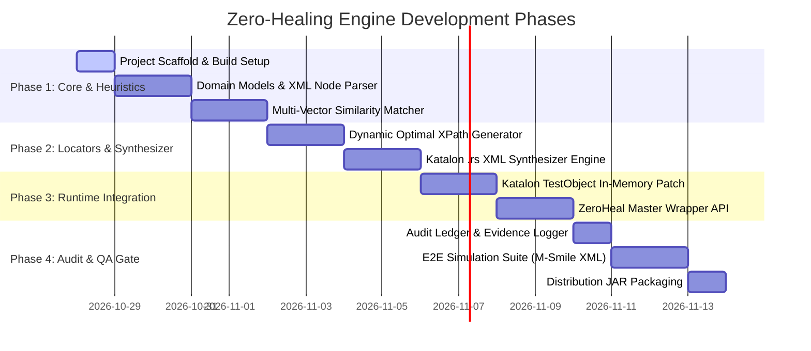

# Locara by Qureon — Master Implementation Plan & Architecture Specification

> **Target Ecosystem**: Katalon Studio (Mobile / Web) & Appium Automation Framework  
> **Core Runtime**: Java 17/21 (Modular JVM Library / Katalon Custom Keyword Plugin)  
> **Status**: Implementation Baseline  
> **Organization**: Qureon Open Source  

---

## 🎯 Executive Summary & Mission

**Zero-Healing** adalah *engine* automasi otonom yang dirancang khusus untuk menutup kelemahan fatal self-healing bawaan Katalon Studio. 

Alih-alih hanya mengandalkan locator cadangan yang sudah di-spy sebelumnya, **Zero-Healing** memiliki kemampuan:
1. **Zero-Failure In-Flight Execution**: Mencegat kegagalan `NoSuchElementException` / `StepFailedException` saat test case berjalan.
2. **Autonomous XML Heuristic Analysis**: Mengambil pohon hierarki UI (`driver.getPageSource()`) secara real-time dan menganalisis elemen target menggunakan multi-vector similarity scoring (Text, ID, Content-Desc, Class, Bounds, Sibling Context).
3. **In-Memory Hotfix**: Menyuntikkan locator baru ke dalam memori `TestObject` Katalon saat itu juga sehingga *action* dapat di-retry dan test case lolos tanpa henti.
4. **Auto-Synthesizing Object Repository (`.rs`)**: Secara otomatis membuat file XML `.rs` resmi standar Katalon Studio dan menyimpannya langsung ke struktur folder proyek (`Object Repository/...`), membuat test case di masa depan tidak perlu healing lagi.
5. **Traceable Audit Ledger**: Mencatat bukti perbaikan, skor keyakinan (*confidence score*), dan screenshot sebelum/sesudah ke dalam berkas log UAT.

---

## 🏛️ System Architecture Topology

```
┌─────────────────────────────────────────────────────────────────────────────┐
│                          KATALON STUDIO TEST RUNNER                          │
│                                                                             │
│  [Test Case Step] ──► ZeroHeal.tap(findTestObject('...'), 'Lanjut Bayar')   │
└──────────────────────────────────────┬──────────────────────────────────────┘
                                       │
                                       ▼
┌─────────────────────────────────────────────────────────────────────────────┐
│                           ZERO-HEALING RUNTIME CORE                         │
│                                                                             │
│  ┌───────────────────────┐             ┌─────────────────────────────────┐  │
│  │ 1. Interceptor Layer  │ ──(Fail)──► │ 2. Live PageSource XML Dump     │  │
│  │    (Try-Catch Wrapper)│             │    (Appium / MobileDriver)      │  │
│  └───────────────────────┘             └────────────────┬────────────────┘  │
│                                                         │                   │
│                                                         ▼                   │
│  ┌───────────────────────┐             ┌─────────────────────────────────┐  │
│  │ 4. In-Memory Hotfix   │ ◄──(Score)──│ 3. Multi-Vector Heuristic Scorer│  │
│  │    & Action Retry     │             │    - Fuzzy Text (Jaro-Winkler)  │  │
│  └───────────┬───────────┘             │    - Semantic Resource ID       │  │
│              │                         │    - Content-Desc & Hierarchy   │  │
│              │                         │    - Bounds & Clickable Filter  │  │
│              │                         └─────────────────────────────────┘  │
│              ▼                                                              │
│  ┌───────────────────────┐             ┌─────────────────────────────────┐  │
│  │ 5. Katalon .rs        │             │ 6. Audit Ledger & Evidence      │  │
│  │    Synthesizer        │             │    (JSON Log + Visual Diff)     │  │
│  └───────────────────────┘             └─────────────────────────────────┘  │
└─────────────────────────────────────────────────────────────────────────────┘
```

---

## 📋 Phased Roadmap & Tasklist



---

### 🔹 Phase 1: Core Domain, XML Hierarchy Parser & Heuristic Matcher
Fondasi inti tanpa dependensi berat, fokus pada pemrosesan string, AST tree, dan algoritma scoring deterministik.

- [x] **Task 1.1 — Workspace & Build Scaffold**:
  - Konfigurasi struktur Gradle / Java (Java 17/21 target).
  - Setup modular package: `com.zerohealing.core.model`, `com.zerohealing.core.parser`, `com.zerohealing.core.matcher`, `com.zerohealing.core.generator`, `com.zerohealing.katalon`.
- [x] **Task 1.2 — UI Element Node Data Model**:
  - Implementasi immutable model `UIElementNode`:
    - `tag`, `resourceId`, `text`, `contentDesc`, `className`, `xpath`, `bounds` (`Rectangle`), `clickable`, `displayed`, `enabled`, `parent`, `children`.
- [x] **Task 1.3 — Ultra-Fast PageSource XML Parser**:
  - Parser DOM/StAX native Java yang memproses raw XML dari UIAutomator2 / XCUITest dalam waktu `<50ms`.
  - Normalisasi atribut Android (`resource-id`, `content-desc`, `bounds="[x1,y1][x2,y2]"`) dan iOS (`name`, `label`, `value`).
- [x] **Task 1.4 — Multi-Vector Scoring Engine**:
  - Integrasi algoritma similarity:
    - **Jaro-Winkler & Levenshtein Distance**: Pencocokan teks fleksibel terhadap typo atau perubahan minor label (misal *"Bayar Sekarang"* vs *"Konfirmasi Pembayaran"*).
    - **Semantic Token Overlap**: Normalisasi snake_case / camelCase pada `resource-id` (misal `btn_submit_trx` vs `btn_lanjut`).
  - Scoring Weights (Dapat dikonfigurasi via `zero-healing.properties`):
    - Text Match: `35%`
    - Resource ID: `25%`
    - Content-Description / Accessibility ID: `20%`
    - Class Type & Clickable Status: `10%`
    - UI Sibling / Parent Proximity: `10%`
  - Acceptance threshold: `Confidence >= 0.80`.

---

### 🔹 Phase 2: Dynamic XPath Generator & Katalon `.rs` Synthesizer
Penciptaan locator tangguh dan generator berkas fisik Object Repository resmi Katalon.

- [x] **Task 2.1 — Robust Dynamic XPath Generator**:
  - Menghasilkan XPath yang tahan terhadap perubahan layout dinamis:
    - Prioritas 1: `//<class>[@resource-id='...' and @text='...']`
    - Prioritas 2: `//<class>[@content-desc='...']`
    - Prioritas 3: Hierarchical relative path dengan anchor teks unik terdekat.
  - Validasi keunikan (*uniqueness check*): Memastikan XPath yang dihasilkan hanya memilih tepat 1 node di pohon XML aktif.
- [x] **Task 2.2 — Katalon `.rs` (WebElementEntity) Synthesizer**:
  - Template generator XML standar Katalon Studio yang 100% valid schema:
    - Tag `<WebElementEntity>`, `<elementGuidId>`, `<selectorCollection>`, `<selectorMethod>XPATH</selectorMethod>`, `<smartLocatorEnabled>false</smartLocatorEnabled>`.
  - Format output konsisten dengan format Object Repository hasil Spy manual Rio.
- [x] **Task 2.3 — Repository Storage Manager**:
  - Resolver lokasi file otomatis ke direktori `Object Repository/...`.
  - Sanitasi karakter path (`/` dan `\` disesuaikan dengan OS dan konvensi Katalon).
  - Safety Invariant: Mode `SAFE_CREATE` (tidak menimpa file eksisting secara sembrono; jika sudah ada, tambahkan suffix `.healed.rs` atau update properti selector dengan backup).

---

### 🔹 Phase 3: Runtime Interceptor & Katalon In-Memory Patching
Jembatan runtime yang menghubungkan engine langsung ke eksekusi test case Katalon.

- [x] **Task 3.1 — Katalon `TestObject` In-Memory Mutator**:
  - Memodifikasi instance `com.kms.katalon.core.testobject.TestObject` secara langsung di memori JVM saat error terjadi:
    - `testObject.setSelectorMethod(SelectorMethod.XPATH)`
    - `testObject.setSelectorValue(SelectorMethod.XPATH, healedXPath)`
  - Memastikan eksekusi retry Katalon langsung mengenali selector baru tanpa harus reload test case.
- [x] **Task 3.2 — Appium Driver Live Bridge**:
  - Penghubung reflektif ke `MobileDriverFactory.getMobileDriver()` untuk mengekstrak `getPageSource()` dan mengeksekusi aksi instan (`click()`, `sendKeys()`).
- [x] **Task 3.3 — `ZeroHeal` Master Keywords API**:
  - Menyediakan wrapper publik yang bersih untuk Test Case / Screen Flow:
    ```groovy
    // Mode 1: Healing pada object yang sudah ada tapi rusak/berubah
    ZeroHeal.tap(findTestObject('Object Repository/M-Smile/btn_Bayar'), 'Tombol Bayar')
    
    // Mode 2: Auto-Spy & Heal pada object yang belum pernah di-spy sama sekali!
    ZeroHeal.tapByHint('Lanjut Transfer', 'Object Repository/M-Smile/Transfer/btn_Lanjut')
    
    // Mode 3: Set text dengan auto-healing
    ZeroHeal.setText(findTestObject('Object Repository/M-Smile/input_Nominal'), '100000', 'Input Nominal')
    ```

---

### 🔹 Phase 4: Audit Ledger, Visual Evidence & Simulation Suite
Pelaporan kepatuhan UAT dan pengujian komprehensif sebelum deployment ke production.

- [x] **Task 4.1 — Healing Audit Ledger (JSON & Markdown)**:
  - Pencatatan otomatis ke `Include/evidence/healing_audit.json`:
    - `timestamp`, `screenContext`, `targetHint`, `originalLocator`, `healedXPath`, `confidenceScore`, `generatedRsPath`, `executionStatus`.
- [x] **Task 4.2 — Visual Bounding Box Annotator**:
  - Pengambilan screenshot saat healing terjadi dengan koordinat elemen pemenang (`bounds`).
- [x] **Task 4.3 — Comprehensive Unit & Mutation Test Suite**:
  - Menguji parser dan scoring engine dengan sampel raw XML M-Smile Bank Mega nyata (layar login, dashboard, transfer confirmation, MPN, QRIS).
  - Memastikan waktu eksekusi end-to-end healing di bawah `1.5 detik`.
- [x] **Task 4.4 — Packaging & Distribution (.jar)**:
  - Build fat JAR (`zero-healing-1.0.0.jar`) siap drop ke folder `Drivers/` proyek Katalon Studio.

---

### 🔹 Phase 5: God-Tier Enterprise Enhancements (Bank Mega Hardening)
Fitur tingkat lanjut untuk keandalan maksimal di environment UAT nyata Bank Mega.

- [x] **Task 5.1 — Bank Mega Danger-Lockout Policy & Semantic Polarity Guard**:
  - Deteksi kata kunci berisiko tinggi (*negative danger dictionary*: `hapus`, `delete`, `batal`, `cancel`, `blokir`, `keluar`).
  - Strict Polarity Check: Mencegah *false positive* klik pada tombol berlawanan semantik jika target hint adalah aksi positif (*"Lanjut"* / *"Bayar"*).
- [x] **Task 5.2 — Auto-Scroll & Off-screen Viewport Recovery Engine**:
  - Deteksi kontainer `scrollable="true"`.
  - Melakukan swipe down otomatis (1-2x) saat elemen target berada di bawah lipatan layar (*below the fold*), lalu re-dump XML dan re-evaluasi.
- [x] **Task 5.3 — The Golden Triad Virtual Keyboard Detection & Auto-Dismiss**:
  - Deteksi posisi elemen target terhadap viewport keyboard virtual (y > 55% screen).
  - Melakukan auto-dismiss keyboard (`Mobile.hideKeyboard()`) jika elemen tertutup atau terjadi tap failure.
- [x] **Task 5.4 — Standalone CLI Quick-Spy & XML Analyzer**:
  - Entry point `com.zerohealing.cli.ZeroHealCli` untuk menjalankan analisis cepat dan auto-generate `.rs` langsung dari terminal tanpa perlu membuka Katalon Studio.
- [x] **Task 5.5 — Zero-Code-Change Katalon Test Listener**:
  - Listener Katalon `@AfterTestCase` yang otomatis menganalisis step gagal, membuat file `.rs` hasil heal, dan mencatat rekomendasi perbaikan tanpa perlu mengubah baris kode script eksisting.

---

### 🔹 Phase 6: Surgical Hardening, Zero-Loss Financial Invariants & Enterprise Compliance
Perlindungan mutlak tingkat enterprise perbankan (Bank Mega Zero-Loss Standard) untuk menjamin nol kerugian finansial, nol false green, dan perlindungan total repositori .rs Mas Rio.

- [x] **Task 6.1 — Financial & Danger Polarity Guard Hardening (`DangerKeywordGuard`)**:
  - Penambahan kamus transaksi finansial (`"transfer"`, `"topup"`, `"debet"`, `"debit"`, `"tarik"`, `"beli"`, `"buy"`) ke `POSITIVE_KEYWORDS`.
  - Strict Neutral-to-Destructive Barrier: Target non-danger/netral mutlak menolak elemen kandidat berunsur destruktif (`"hapus"`, `"delete"`, `"batal"`, `"blokir"`, dll.).
- [x] **Task 6.2 — Object Repository Anti-Tampering & Isolated Quarantine Routing (`KatalonRsSynthesizer`)**:
  - Default `autoGenerateRs = false` pada runtime regression test.
  - Jika diaktifkan, route file hasil sintesis ke `Object Repository/ZeroHeal_AutoGenerated/`, dilarang menimpa file `.rs` hasil spy manual Mas Rio.
- [x] **Task 6.3 — Keyboard Guard & Viewport Scroll Bounds Hardening (`KeyboardGuard`, `ScrollRecoveryEngine`)**:
  - Proteksi auto-dismiss keyboard agar tidak membabi buta mengirim keycode Back pada tombol bagian bawah layar.
  - Sanitasi batas koordinat swipe untuk mencegah crash out-of-bounds pada resolusi 720p/HD.
- [x] **Task 6.4 — Localhost Telemetry Security (`server.py`)**:
  - Bind server dashboard ke `127.0.0.1` lokal murni.
- [x] **Task 6.5 — Verification & Comprehensive Regression Suite**:
  - Validasi unit test keselamatan dan build fat JAR.

---

## 🛡️ Supreme Invariants & Safety Measures

1. **Anti-Accidental Overwrite**: Generator `.rs` tidak boleh menghapus file locator asli tanpa persetujuan. Jika locator lama diubah, file asli di-backup menjadi `[Name].backup.rs`.
2. **False-Positive Guard**: Jika confidence score tertinggi di bawah threshold (misal `< 0.80`), engine **TIDAK BOLEH** menebak sembarangan dan wajib membiarkan step *fail* secara terhormat untuk mencegah salah klik tombol berbahaya (misal tombol *Hapus* alih-alih *Batal*).
3. **Danger Polarity Invariant**: Jika target hint bermakna positif, tapi kandidat terdekat mengandung kata kunci destructive/danger, engine WAJIB menolak kandidat tersebut.
4. **Safe Teardown Preservation**: Kegagalan healing tetap memicu blok `finally` untuk menjalankan `ResetToDashboardUtil.resetToDashboard()`.
